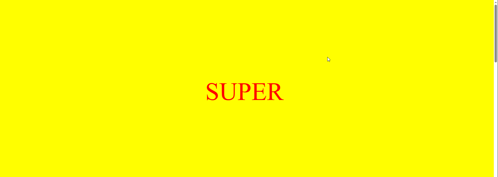

# База знаний CSS

Здесь вы можете делиться знаниями, связанными с CSS. 

- [Grid песочница](https://grid.layoutit.com/)
- [Набор интересных CSS анимаций](https://animista.net/play/basic)
- [nebo.css](https://github.com/htmlacademy/nebo.css) - небольшой css код, который позволяет делать вогнутые и выпуклые углы.
- [Кнопка с градиентной закруглённой границей и прозрачным фоном](https://codepen.io/fanmanutd/pen/dyjxzOB)
- [Переход и смена блока между разными частями страницы.](https://codepen.io/fanmanutd/pen/LYXPJEL)

  Основано на [этой статье](https://css-tricks.com/going-from-solid-to-knockout-text-on-scroll/), как пример ипользования: 
  
- [Определить цвет пикселя онлайн](https://sanstv.ru/color)