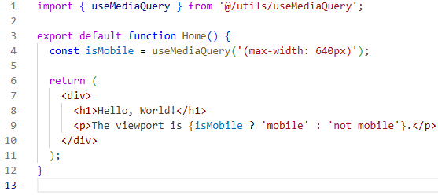

# useMediaQuery

## Описание

Хук, принимающий строку CSS медиа запроса и возвращающий `boolean`.

## Преимущества

1. Использует хук [useSyncExternalStore](https://react.dev/reference/react/useSyncExternalStore#subscribing-to-a-browser-api) - современное API React для синхронизации с внешним состоянием. 
2. Использует `matchMedia` [Web API](https://developer.mozilla.org/en-US/docs/Web/API/Window/matchMedia), который триггерит изменение состояния один раз при прохождении границы медиа запроса, в отличии от события window `resize`.

## Пример

## Зависимости

`react`
