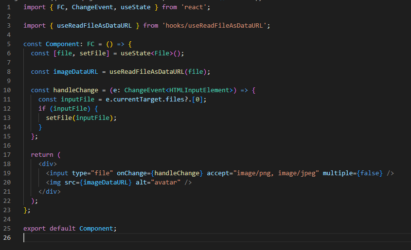

# useReadFileAsDataURL

## Описание

Небольшой хук принимающий `Blob` или `File` и возвращающий строку в формате `base64`. Если это изображение, строку можно передать атрибуту `src` тега `img`.

## Использование

Передайте `File` или `Blob`, хук вернёт строку в формате `base64`. 

## Пример

## Зависимости

`react`
